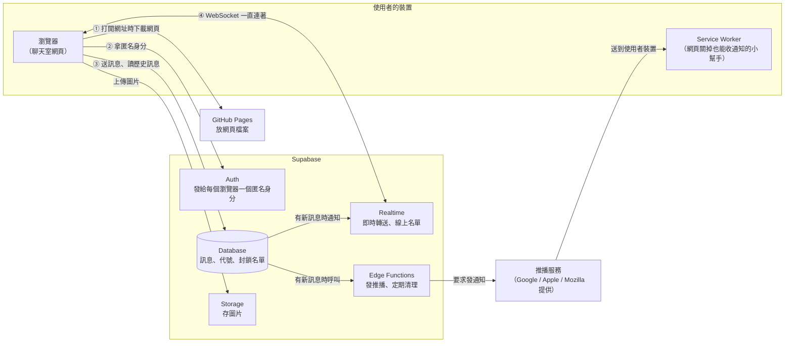
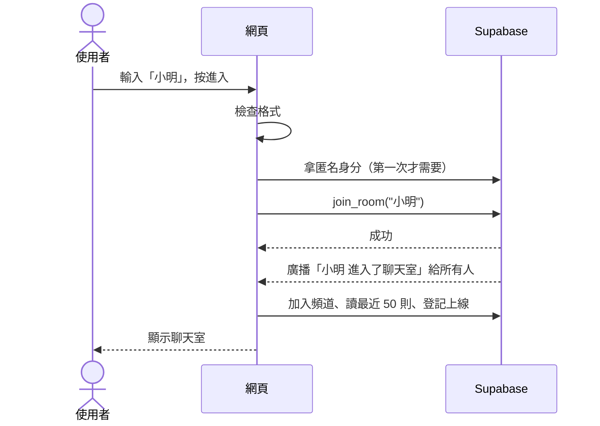

# 匿名聊天室：架構文件

> 這份文件寫給「不寫程式、但要決定這個專案長什麼樣子」的人看。
> 專有名詞第一次出現時，會用一句話解釋；文件最後也有一張「名詞小抄」可以回頭查。
> 需求來源：`docs/requirements.md`，以及需求訪談時你做的 9 個決定（整理在第 1 節）。

---

## 1. 專案說明與目標

### 這是什麼
一個**不用註冊、不用登入**的匿名聊天室。任何拿到網址的人，用電腦或手機打開網頁、取一個代號，就能進到**唯一一個**大家共用的聊天室裡聊天。

### 目標
1. 打開網址 → 輸入代號 → 馬上能聊，整個過程不超過 10 秒。
2. 電腦和手機都好用（手機是主要情境之一，不是附帶的）。
3. 費用為 0：網頁放在 GitHub Pages、後端用 Supabase 免費方案。
4. 先做出「看得到、摸得到」的前端，最後才接上真正的後端，而且接的時候**不用重寫畫面**。

### 訪談時你做的決定
| # | 項目 | 決定 |
|---|---|---|
| 1 | 歷史訊息 | 進來時看得到最近 50 則 |
| 2 | 代號重複 | 不准重複；正在用的代號別人不能用 |
| 3 | 重新打開網頁 | 輸入框自動填好上次的代號，按「進入」才進去 |
| 4 | 訊息內容 | 文字、可點的網址、圖片 |
| 5 | 收回／修改 | 可以收回、也可以修改（顯示「已編輯」） |
| 6 | 管理 | 你是管理員，可以刪任何訊息、把人踢出；系統另外自動限制洗版 |
| 7 | 進入／離開提示 | 以灰色小字寫在聊天紀錄裡 |
| 8 | 新訊息提醒 | 跳出系統通知（手機也要） |
| 9 | 通知頻率 | 每個人自己選「全部／只有 @ 我／關閉」，預設「只有 @ 我」 |

---

## 2. 整體架構圖

先認識三個角色：

- **瀏覽器**：使用者手上的 Chrome、Safari 等。聊天室的程式其實是在這裡執行的。
- **GitHub Pages**：GitHub 提供的免費網站空間，只負責「把網頁檔案交給瀏覽器」，它本身不會記住任何聊天內容。
- **Supabase**：一個現成的線上後端服務（後端＝藏在網頁後面、負責保存資料和轉送訊息的那一端）。訊息、代號、圖片、線上名單都由它處理。



**用一段話說明這張圖：**
使用者打開網址，瀏覽器先從 GitHub Pages 下載網頁（①）。網頁向 Supabase 拿一個匿名身分（②），之後送訊息時都帶著這個身分，Supabase 才知道「這則訊息是誰送的」（③）。瀏覽器和 Supabase 之間會一直保持一條 **WebSocket** 連線（④，WebSocket 是一種不會掛斷的連線，像一直通著的電話，有新訊息時伺服器能主動推過來，不用網頁一直問「有沒有新的？」）。
有人送出新訊息時，資料庫會同時做兩件事：透過 Realtime 推給所有開著網頁的人，並請 Edge Function 發推播通知給沒在看的人。

> GitHub Pages 跟 Supabase 之間**沒有直接關係**。GitHub Pages 只負責交出網頁，交出去之後的所有事情都是瀏覽器直接跟 Supabase 溝通。

---

## 3. 技術選擇

### 3.1 前端

前端＝使用者看到、操作的那一端，也就是網頁本身。

| 項目 | 選了什麼 | 為什麼 |
|---|---|---|
| 語言 | **TypeScript** | TypeScript 是「加上型別檢查的 JavaScript」（JavaScript 是瀏覽器唯一聽得懂的程式語言；型別檢查會在程式執行前抓出「把文字當數字用」這類錯誤）。這個專案有一份「通訊約定」（第 5 節），TypeScript 能讓畫面和通訊兩邊照著同一份約定寫，寫錯了在存檔時就會被抓出來，不用等到使用者碰到才發現。 |
| 畫面框架 | **React** | React 是一套用來組畫面的工具，把畫面拆成一塊一塊的「元件」（訊息、輸入框、線上名單……）。選它的原因：(1) 使用的人最多，遇到問題最容易查到答案；(2) `/frontend-design` 產出的程式通常就是 React，可以直接用；(3) 它預設會把使用者輸入的文字當成純文字顯示，不會被當成程式執行，這是安全上很重要的一道防線（見第 9 節）。 |
| 打包工具 | **Vite** | 打包工具負責把我們寫的很多個檔案，整理成瀏覽器能直接讀的少數幾個檔案。Vite 速度快、設定少，而且打包出來的就是一般的網頁檔案，可以直接放上 GitHub Pages。 |
| 換頁方式 | **不用換頁套件**，用網址的 `#` 區分 | 這個聊天室只有幾個畫面，用「目前狀態」切換就夠了。GitHub Pages 遇到 `/admin` 這種網址會找不到檔案而顯示 404，管理員入口改用 `網址#admin` 就沒有這個問題。 |
| 樣式 | 照 `/design`、`/frontend-design` 的產出決定，預設用一般 CSS 檔 | 顏色和樣式不在這份文件的範圍內。 |
| 連到 Supabase | **supabase-js**（Supabase 官方提供的程式庫） | 登入、讀寫資料、WebSocket、上傳圖片都包在裡面，斷線後也會自動重連。 |
| 自動測試 | **Vitest** | 用來測「檢查代號是否合法」、「把網址變成連結」這類規則，確保之後改程式時沒有把它們改壞。 |
| 套件管理 | **npm**，Node.js 用 LTS 版 | Node.js 是讓你在自己電腦上執行開發工具的程式；npm 是它附的「下載套件」工具。LTS 是長期維護版，最穩定。 |

### 3.2 Supabase 用到的功能

| 功能 | 用來做什麼 | 為什麼 |
|---|---|---|
| **Auth：匿名登入**（Anonymous Sign-ins） | 使用者第一次進來時，在背景自動拿到一個隨機身分，使用者完全感覺不到。 | 「不用登入」是對使用者來說的，系統還是要知道「這則訊息是不是你送的」才能讓你收回、修改。匿名登入剛好提供這個身分，而且身分會存在瀏覽器裡，重新整理後還是同一個人。 |
| **Auth：Email + 密碼** | 只給你（管理員）一個人用。 | 管理員密碼如果寫在網頁程式裡，任何人打開網頁原始碼都看得到。改用 Supabase 的帳號登入，密碼只存在 Supabase，網頁裡只有一個登入表單。 |
| **Database**（PostgreSQL 資料庫） | 存訊息、目前誰佔用哪個代號、封鎖名單、管理員名單、推播訂閱。 | 「最近 50 則」、「代號不能重複」、「收回只能收自己的」這些規則都要有一個所有人共用的地方來判斷，資料庫就是那個地方。 |
| **RLS**（Row Level Security，資料列權限） | 規定「誰可以讀、寫哪一筆資料」。 | 網頁裡的金鑰是公開的（見第 8 節），任何人都能拿它直接連資料庫。真正擋住壞人的是 RLS：例如「只能修改 `author_id` 等於自己的訊息」。 |
| **資料庫函式**（RPC） | 所有「寫入」動作都透過預先寫好的函式完成，例如 `send_message`、`join_room`。 | 函式在 Supabase 那一端執行，可以一次把規則檢查完：有沒有被封鎖、是不是洗版、代號是不是你的。使用者沒辦法跳過這些檢查。 |
| **Realtime：Broadcast**（廣播） | 新訊息、修改、收回、刪除即時推給每個人。 | 由資料庫在資料改變時主動廣播出去。使用者只能「收」，不能自己亂廣播。 |
| **Realtime：Presence**（在線狀態） | 「誰在線上」名單。 | Presence 專門處理「誰現在連著」，有人斷線時會自動把他移出名單，不需要我們自己記錄。 |
| **Realtime Authorization**（私人頻道） | 只有拿到身分、而且沒被封鎖的人，才能加入聊天室頻道。 | 被踢的人就算不理會畫面上的提示，也收不到新訊息、進不了線上名單。 |
| **Storage** | 存使用者傳的圖片。 | 圖片不適合存在資料庫裡。Storage 可以限制檔案大小和類型，並且規定每個人只能上傳到自己的資料夾。 |
| **Edge Functions** | (1) `send-push`：有新訊息時發推播通知；(2) `cleanup`：每天刪掉 7 天前的訊息和圖片。 | Edge Function 是放在 Supabase 上、由 Supabase 幫你執行的一小段程式。這兩件事都需要「最高權限金鑰」或「推播私鑰」，這兩把鑰匙絕對不能放進網頁，只能在這裡用。 |
| **Cron**（pg_cron，排程） | 每分鐘把「心跳停止」的人標為離開；每天叫一次 `cleanup`。 | Cron 是「定時鬧鐘」，到時間就自動做某件事。手機關掉網頁時通常來不及通知伺服器，只能靠伺服器定時檢查。 |
| **Vault**（保險箱） | 存放資料庫呼叫 Edge Function 時用的內部密碼。 | 這個密碼要在資料庫裡使用，Vault 是 Supabase 在資料庫裡安全存放密碼的地方。 |

### 3.3 其他
- **Web Push**（網頁推播）＋ **Service Worker**：Service Worker 是網頁在背景安裝的一個小程式，網頁關掉了也能接收推播、跳出通知。決定 #8 要求手機也收得到通知，就一定要用到這兩個東西。
- **PWA**（Progressive Web App，可安裝的網頁）：讓網頁可以「加到主畫面」，看起來像一個 App。**iPhone 必須先加到主畫面，才收得到網頁推播**，這是 Apple 的限制，我們沒辦法繞過。

---

## 4. 兩個階段

### 4.0 關鍵設計：一個「通訊層」插座

整個前端分成兩層：

```
┌─────────────────────────────┐
│  畫面層（React 元件）         │  ← /design、/frontend-design 負責
│  進入畫面、訊息列表、輸入框…   │
└──────────────┬──────────────┘
               │ 只透過「通訊約定」（第 5 節）溝通
┌──────────────┴──────────────┐
│  通訊層（ChatService）        │
│  ├─ 階段一：示範版 MockChatService      │
│  └─ 階段二：正式版 SupabaseChatService  │
└─────────────────────────────┘
```

可以把通訊層想成牆上的**插座**：畫面層是電器，只認插座的形狀（第 5 節的通訊約定），不管電是從哪裡來的。
- 階段一插的是「示範用電池」：假的通訊層，在瀏覽器裡模擬其他人。
- 階段二換成「市電」：真的接到 Supabase。

**規則：畫面層的任何檔案都不可以直接使用 Supabase。** 所有跟 Supabase 有關的程式都只能寫在 `src/chat/supabase/` 裡。守住這條規則，換插座時畫面層就一行都不用改。

要用哪一個通訊層是自動決定的：

| 情況 | 使用 |
|---|---|
| 沒有設定 Supabase 的網址和金鑰 | 示範版 |
| 有設定 | 正式版 |
| 網址加上 `?demo` | 強制使用示範版（方便之後展示或測試畫面） |

### 4.1 階段一：只有前端（示範模式）

**要做到的程度：除了「真的跨裝置聊天」和「網頁關掉也能收到通知」以外，畫面和操作都跟正式版一樣。**

示範版通訊層怎麼模擬：

| 功能 | 示範版怎麼做 |
|---|---|
| 多人聊天 | 同一個瀏覽器開好幾個分頁，每個分頁算一個人，分頁之間用 **BroadcastChannel** 互傳訊息（BroadcastChannel 是瀏覽器內建、讓同一個網站的分頁互相講話的功能）。 |
| 只有一個分頁時 | 網址加 `?bots`，會出現 2 個「示範機器人」：偶爾進來、說話、@你、離開。只用一支手機也能看到完整效果。 |
| 最近 50 則 | 存在這個瀏覽器的 localStorage（瀏覽器給每個網站的一小塊儲存空間）。重新整理後還在，換瀏覽器就看不到。 |
| 代號不能重複 | 分頁之間互相檢查。 |
| 圖片 | 一樣會壓縮、預覽、送出，但只存在記憶體裡，重新整理後圖片會變成「示範模式不保留圖片」。 |
| 收回／修改 | 完整可用。 |
| 管理員 | 打開 `網址#admin`，任何 Email 加上密碼 `demo` 就能登入，畫面上會清楚標示「示範」。 |
| 斷線／重連 | 輸入框旁有一個開發用的「模擬斷線」開關，用來檢查斷線時的畫面。 |
| 通知 | 用瀏覽器內建的通知功能：分頁切到背景時，收到新訊息會跳通知（電腦上看得到效果）。網頁關掉後的推播要等階段二。 |

畫面最上方會一直顯示一條提示：**「示範模式：訊息只在這個瀏覽器的分頁之間傳遞，別人看不到。」** 避免有人以為已經可以正式使用。

**怎麼在 GitHub Pages 上看到效果：**
1. 程式推到 GitHub 的 `main` 分支後，GitHub Actions 會自動打包並發布（細節見第 12 節）。
2. 打開 `https://<你的 GitHub 帳號>.github.io/<repo 名稱>/`。
3. 開兩個分頁，各取一個代號，就能互相聊天；手機打開 `…/?bots`，就能跟機器人聊。

### 4.2 階段二：接上 Supabase

| 項目 | 階段一 → 階段二 的變化 |
|---|---|
| 聊天範圍 | 同一個瀏覽器的分頁 → 全世界任何裝置 |
| 歷史訊息 | 只存在自己的瀏覽器 → 存在資料庫，所有人看到的一樣；保留 7 天 |
| 代號 | 分頁之間檢查 → 資料庫保證全世界不重複 |
| 圖片 | 重新整理就消失 → 存在 Storage |
| 身分 | 每個分頁隨機產生 → Supabase 匿名身分，同一個瀏覽器重新整理後還是同一個人 |
| 管理員 | 密碼 `demo` → 你的 Supabase 管理員帳號 |
| 洗版限制 | 只有前端擋 → 前端擋＋資料庫再擋一次（真正有效的是資料庫這一關） |
| 通知 | 只有分頁在背景時 → 加上 Web Push，網頁關掉也收得到 |
| 示範提示條 | 移除 |

**階段二要新增的程式（畫面層不用動）：**
- `src/chat/supabase/` 裡的正式版通訊層
- `supabase/migrations/`：建立資料表、權限規則、資料庫函式的 SQL 檔（SQL 是操作資料庫用的語言）
- `supabase/functions/`：兩個 Edge Function
- `public/sw.js`：Service Worker
- 通知設定畫面加上「在這台裝置啟用推播」按鈕。這個按鈕在階段一就先放好，只是會顯示「示範模式不支援」。

**階段二的設定步驟**（實際操作時會另外寫成一步一步的說明）：
1. 在 supabase.com 建立專案，記下資料庫密碼（存到密碼管理器）。
2. 打開「匿名登入」功能（Authentication → Sign In / Providers → Anonymous）。
3. 執行 `supabase/migrations/` 裡的 SQL，建立資料表和規則。
4. 建立 Storage bucket `chat-images`（bucket 是 Storage 裡的一個資料夾），設定上限 2 MB，只接受圖片格式。
5. 建立你的管理員帳號，把它的 ID 加進 `admins` 資料表。
6. 產生推播用的 VAPID 金鑰（見第 8 節），部署兩個 Edge Function。
7. 打開 Cron，設定排程。
8. 在 GitHub repo 設定三個變數（見第 8 節），重新部署。

### 4.3 讓兩個階段不用重寫的五條規則
1. 畫面層只認識第 5 節的通訊約定。
2. 畫面層的任何檔案都不可以直接使用 Supabase。
3. 示範版和正式版都必須完整做出約定裡的每一個功能和每一種錯誤。示範版不能偷懶只回傳「成功」，不然畫面層就不會處理錯誤，等到階段二才發現漏掉。
4. 規則（代號長度、訊息長度、洗版頻率）集中寫在 `src/chat/rules.ts` 一個地方，兩個版本共用；資料庫裡的檢查使用相同的數字。
5. 從階段一開始，所有時間都用伺服器格式（ISO 8601，例如 `2026-10-13T08:30:00Z`）、所有 ID 都用 UUID（一種隨機產生、幾乎不可能重複的長字串）。

---

## 5. 通訊約定

這一節是畫面層和通訊層之間的「合約」，兩個版本都要照著做。

### 5.1 畫面能叫通訊層做的事（動作）

| 動作 | 需要給什麼 | 可能的結果 |
|---|---|---|
| `join` 進入聊天室 | 代號 | 成功／`nickname_taken` 代號有人用／`nickname_invalid` 代號不合規則／`banned` 被封鎖中 |
| `leave` 離開 | — | 成功 |
| `loadRecent` 讀最近訊息 | 數量（預設 50） | 訊息清單（由舊到新） |
| `sendMessage` 送訊息 | 文字（可空）、圖片（可空）、@ 了誰 | 成功／`rate_limited` 太快了／`too_long` 太長／`image_too_large` 圖片太大／`image_type_not_allowed` 不支援的格式／`banned` |
| `editMessage` 修改 | 訊息 ID、新文字 | 成功／`not_owner` 不是你的／`too_long`／`message_gone` 訊息已經不在 |
| `recallMessage` 收回 | 訊息 ID | 成功／`not_owner`／`message_gone` |
| `adminLogin` 管理員登入 | Email、密碼 | 成功／`wrong_credentials` 帳號或密碼錯誤／`not_admin` 不是管理員 |
| `adminRemoveMessage` 管理員刪訊息 | 訊息 ID | 成功／`not_admin` |
| `adminKick` 踢人 | 對方的使用者 ID、時間（1 小時／24 小時／7 天） | 成功／`not_admin` |
| `setNotifyMode` 設定通知 | `all`／`mentions`／`off` | 成功 |
| `enablePush` 在這台裝置啟用推播 | — | 成功／`permission_denied` 使用者拒絕／`unsupported` 不支援（例如 iPhone 還沒加到主畫面） |

所有失敗都有一個固定的英文代碼（上表的 `nickname_taken` 等），畫面層看代碼決定顯示哪一句中文。另外有一個共用的代碼 `network`，代表「網路有問題，請稍後再試」。

### 5.2 通訊層主動告訴畫面的事（事件）

| 事件名稱 | 什麼時候發生 | 帶的資料 |
|---|---|---|
| `message:new` | 有新訊息（包括系統訊息「○○ 進入了聊天室」） | 一則訊息 |
| `message:updated` | 訊息被修改、收回或被管理員刪除 | 更新後的整則訊息 |
| `presence:sync` | 線上名單有變化 | 目前在線的人（完整清單） |
| `connection:status` | 連線狀態改變 | `connecting` 連線中／`online` 已連線／`reconnecting` 重新連線中／`offline` 已離線 |
| `me:kicked` | 自己被踢出 | 到什麼時候解除 |
| `me:nickname_lost` | 斷線太久，代號被別人拿走了 | 原本的代號 |

### 5.3 資料格式

**一則訊息（`ChatMessage`）**

```json
{
  "id": "8f0c6a1e-3b7d-4c55-9a2e-1d2f3a4b5c6d",
  "kind": "user",
  "createdAt": "2026-10-13T08:30:00Z",
  "authorId": "b1e2…",
  "nickname": "小明",
  "isAdmin": false,
  "text": "看這張 https://example.com @阿華",
  "image": { "url": "https://…/chat-images/b1e2…/xxx.webp", "width": 1200, "height": 900 },
  "mentions": ["阿華"],
  "editedAt": null,
  "status": "normal"
}
```

| 欄位 | 意思 |
|---|---|
| `id` | 這則訊息的唯一編號 |
| `kind` | `user` 一般訊息／`system` 系統訊息 |
| `createdAt` | 送出時間（由伺服器決定，不相信使用者電腦的時間） |
| `authorId` | 送出者的匿名身分 ID，用來判斷「這是不是我的訊息」 |
| `nickname` | 送出時使用的代號（由伺服器填入，不能偽造） |
| `isAdmin` | 是不是管理員送的，畫面上加一個標記 |
| `text` | 文字，可以是空的（只傳圖片時） |
| `image` | 圖片，沒有圖片時是 `null` |
| `mentions` | 這則訊息 @ 了哪些代號 |
| `editedAt` | 最後修改時間；沒改過是 `null` |
| `status` | `normal` 正常／`recalled` 已收回／`removed` 被管理員刪除。後面兩種狀態的 `text` 和 `image` 一定是空的，原本的內容已經從伺服器上刪掉，不只是藏起來。 |

**系統訊息（`kind: "system"`）** 只有這幾個欄位：

```json
{
  "id": "…",
  "kind": "system",
  "createdAt": "2026-10-13T08:31:00Z",
  "systemType": "join",
  "nickname": "小明"
}
```
`systemType` 是 `join` 進入、`leave` 離開，或 `kicked` 被管理員請出聊天室。

**線上的人（`OnlineUser`）**

```json
{ "userId": "b1e2…", "nickname": "小明", "isAdmin": false, "isMe": true }
```

### 5.4 階段二的資料表（給之後寫程式的人參考）

| 資料表 | 存什麼 |
|---|---|
| `messages` | 所有訊息（包括系統訊息），欄位跟上面的 `ChatMessage` 一一對應 |
| `members` | 目前誰佔用哪個代號、最後一次心跳的時間。代號存成「統一大小寫後的版本」並設為唯一，資料庫會保證不重複 |
| `bans` | 誰被封鎖、封鎖到什麼時候 |
| `admins` | 哪些帳號是管理員（只有你能用 Supabase 後台加入） |
| `push_subscriptions` | 每台裝置的推播訂閱、通知模式、目前的代號 |

資料庫函式：`join_room`、`heartbeat`、`leave_room`、`send_message`、`edit_message`、`recall_message`、`admin_remove_message`、`admin_kick`、`save_push_subscription`、`set_notify_mode`。

Realtime 頻道只有一個：`room:lobby`（私人頻道）。
- Broadcast 事件 `message_inserted`、`message_updated`：由資料庫在資料改變時發出，使用者不能自己發。
- Presence：每個人用自己的使用者 ID 登記，附上代號和是否為管理員。

---

## 6. 資料流

### 6.1 進入聊天室

1. 打開網頁，輸入框自動填上上次的代號（存在 localStorage）。
2. 按「進入」，前端先檢查代號格式；不合規則就直接顯示錯誤，不送出。
3. 如果這個瀏覽器還沒有匿名身分，就在背景向 Supabase 拿一個。之後重新整理也會沿用同一個身分。
4. 呼叫 `join_room(代號)`，資料庫在同一個步驟裡完成以下檢查：
   - 有沒有被封鎖？有 → 回傳 `banned`
   - 這個代號有沒有人正在用（最後心跳在 60 秒內）？
     - 是別人在用 → 回傳 `nickname_taken`
     - 是自己在用（例如剛重新整理）→ 直接成功，**不再**寫一次「進入了聊天室」
     - 沒人在用 → 登記給你，寫入一則系統訊息「小明 進入了聊天室」
   - 兩個人同時搶同一個代號時，資料庫的「唯一」規則保證只有一個人會成功，另一個人收到 `nickname_taken`。
5. 成功後：加入 `room:lobby` 頻道 → 讀最近 50 則訊息 → 在 Presence 登記自己 → 每 20 秒送一次心跳。
6. 把代號存到 localStorage，下次打開時自動填入。



### 6.2 送出訊息

1. 前端先檢查：文字最多 500 字、不能文字和圖片都是空的、沒有超過頻率限制。
2. 有圖片的話：先在瀏覽器裡壓縮（見 9.1），上傳到 Storage 的 `chat-images/<自己的ID>/<隨機名稱>`。
3. 呼叫 `send_message`，資料庫再檢查一次：有沒有被封鎖、有沒有登記代號、長度、頻率、圖片路徑是不是在自己的資料夾裡。代號由資料庫自己填入，不採用前端傳來的值。
4. 資料寫入後，資料庫自動做兩件事：
   - 透過 Realtime 廣播 `message_inserted` → 每個人的畫面出現這則訊息（包括送出者自己，畫面用 ID 避免重複顯示）。
   - 呼叫 Edge Function `send-push` → 依照每個人的通知設定決定要不要發推播（見 6.6）。
5. 送出到伺服器確認之間，訊息先以「傳送中」的樣子出現在自己的畫面上；失敗的話會標示「傳送失敗，點此重試」。

**修改、收回、管理員刪除**的流程相同：呼叫對應的函式 → 資料庫檢查權限 → 更新資料 → 廣播 `message_updated`。收回或刪除時，資料庫會把文字清空，前端再把 Storage 裡的圖片刪掉。

### 6.3 離開

離開有三種情況：

| 情況 | 發生什麼事 | 「離開」提示多久出現 |
|---|---|---|
| 按「離開」按鈕 | 呼叫 `leave_room` → 釋放代號、寫入「小明 離開了聊天室」 | 馬上 |
| 關掉分頁 | 網頁在關閉前盡量送出 `leave_room`（不一定送得到） | 送到了就馬上；沒送到就跟下一列一樣 |
| 手機切到別的 App、沒電、斷網 | 心跳停了。伺服器每分鐘檢查一次，超過 60 秒沒心跳就釋放代號、寫入離開訊息 | 約 1～2 分鐘 |

**線上名單**用 Presence 判斷，反應比較快：一個人的連線斷掉後，畫面會等 10 秒，他還沒回來才從名單上拿掉。所以可能會出現「名單上已經沒有小明，但聊天紀錄過了一分鐘才出現『小明 離開了』」的情況。這是刻意的設計：寧可晚一點寫「離開」，也不要每次手機訊號不穩，就在聊天紀錄裡留下「進入、離開、進入」。

### 6.4 斷線重連

1. 連線中斷 → 畫面最上方顯示「連線中斷，正在重新連線…」，輸入框還能打字，但「送出」暫停。
2. supabase-js 會自動重試連線。
3. 連回來以後：
   - 送一次心跳。如果代號還是你的 → 繼續聊天；如果中斷超過 60 秒、代號已經被別人拿走 → 回到進入畫面，顯示「你的代號『小明』已經被別人使用，請換一個」。
   - 補抓斷線期間漏掉的訊息（向資料庫要「比我看到的最後一則更新的訊息」），用 ID 去掉重複的。
   - 重新在 Presence 登記。
4. 手機從背景切回來時，也會主動做一次第 3 步，不等連線自己發現斷了。

### 6.5 被管理員踢出
1. 你在某則訊息或線上名單上按「踢出」，選擇時間 → 呼叫 `admin_kick`。
2. 資料庫加入封鎖名單、釋放對方的代號、寫入系統訊息「小明 被管理員請出聊天室」。
3. 被踢的人收到這則系統訊息，發現對象是自己 → 切到「你已被請出聊天室，○○ 後可以再進來」畫面。
4. 就算對方修改網頁程式、不理會這個畫面，資料庫和私人頻道也會拒絕他送訊息和收訊息。

### 6.6 通知
- **網頁開著、你正在看**：不跳通知。
- **網頁開著、但在背景**（切到別的分頁）：由網頁自己跳通知。
- **網頁關掉、手機鎖屏**（階段二）：Edge Function 透過推播服務送到 Service Worker，由它跳出通知。
- 判斷要不要通知：
  - `off` → 不通知
  - `mentions` → 只有訊息的 `mentions` 包含你的代號時才通知
  - `all` → 每則都通知，但 30 秒內的通知會合併成同一則（後面的蓋掉前面的），不會一直響
  - 自己送的訊息永遠不通知自己
- 點通知 → 打開聊天室並捲到那則訊息附近。

---

## 7. 畫面清單

> 這裡只規定「有什麼」和「會做什麼」。長什麼樣子、什麼顏色，交給 `/design`。

### 7.1 進入畫面
| 元素 | 行為 |
|---|---|
| 聊天室名稱、一句說明 | 純顯示 |
| 代號輸入框 | 自動填入上次的代號；1～16 個字；按 Enter 等於按「進入」 |
| 「進入」按鈕 | 代號是空的時候不能按；按下後顯示「進入中…」，避免重複按 |
| 錯誤訊息區 | 依照錯誤代碼顯示：「這個代號有人在用」、「代號不能包含特殊符號」、「你被請出聊天室，○○ 後可以再進來」、「網路有問題，請稍後再試」 |
| 示範模式提示條 | 只在階段一出現 |

### 7.2 聊天室主畫面
**頂部列**
| 元素 | 行為 |
|---|---|
| 聊天室名稱 | 純顯示 |
| 線上人數 | 例如「👥 5」；手機上點了打開線上名單 |
| 通知設定按鈕 | 打開通知設定（7.5） |
| 「離開」按鈕 | 確認後離開，回到進入畫面 |
| 連線狀態條 | 只在斷線或重連時出現 |

**訊息列表**
| 元素 | 行為 |
|---|---|
| 一般訊息 | 代號、時間（今天的只顯示「14:30」，更早的加上日期）、文字、圖片縮圖；管理員有標記；自己的訊息跟別人的看得出差別 |
| 網址 | 自動變成連結，在新分頁打開 |
| @ 提及 | `@代號` 會特別標出；@ 到自己的整則訊息也會特別標出 |
| 「已編輯」 | 修改過的訊息顯示這三個字 |
| 收回／刪除後 | 變成「小明 收回了一則訊息」或「此訊息已被管理員刪除」 |
| 系統訊息 | 灰色小字一行：進入、離開、被請出 |
| 日期分隔線 | 不同天的訊息之間顯示日期 |
| 自己訊息的操作 | 電腦：滑鼠移上去出現「編輯」「收回」；手機：長按出現選單 |
| 管理員的操作 | 每則訊息多了「刪除」「踢出此人」 |
| 「傳送中／傳送失敗」 | 見 6.2 |
| 「有新訊息 ↓」按鈕 | 你往上捲在看舊訊息時有新訊息進來，不會把你拉到最下面，而是出現這個按鈕 |
| 自動捲動 | 你本來就在最底下時，新訊息進來會自動捲到最新 |

**輸入區**
| 元素 | 行為 |
|---|---|
| 文字框 | 可以輸入多行；接近 500 字時顯示剩餘字數 |
| Enter 的行為 | 電腦：Enter 送出、Shift+Enter 換行；手機：Enter 換行，用「送出」按鈕送出（手機上很容易誤按 Enter） |
| @ 選人 | 打 `@` 後跳出線上名單，可以邊打字邊篩選，點一下就填入 |
| 圖片按鈕 | 選擇檔案；手機上可以直接拍照 |
| 貼上／拖曳圖片 | 電腦上直接貼上截圖，或把檔案拖進來 |
| 圖片預覽 | 送出前顯示小圖，可以按 ✕ 拿掉；可以加一段文字一起送 |
| 「送出」按鈕 | 沒有內容時不能按 |
| 編輯模式 | 按「編輯」後，輸入框換成那則訊息的文字，上方顯示「正在編輯，按 Esc 取消」 |

### 7.3 線上名單
- 電腦：固定在右側；手機：從側邊滑出。
- 每一行：代號、管理員標記、自己的旁邊加「（你）」。
- 點某個人 → 在輸入框插入 `@他的代號`。
- 管理員看到的每一行多一個「踢出」。

### 7.4 圖片檢視
- 點縮圖 → 全螢幕顯示原圖。
- 點背景、按 ✕ 或按 Esc 關閉；手機上可以用兩指縮放。

### 7.5 通知設定（對話框）
| 元素 | 行為 |
|---|---|
| 三個選項 | 全部訊息／只有 @ 我（預設）／關閉 |
| 「在這台裝置啟用通知」按鈕 | 請瀏覽器跳出「允許通知嗎？」；已經允許的話顯示「已啟用」 |
| 權限被拒絕時 | 說明如何到瀏覽器設定裡重新打開 |
| iPhone 沒有加到主畫面時 | 圖文說明：「點分享 → 加入主畫面 → 從主畫面打開，再回到這裡啟用」 |

### 7.6 其他畫面與對話框
| 畫面 | 內容 |
|---|---|
| 管理員登入（`網址#admin`） | Email、密碼、「登入」按鈕；登入後回到進入畫面，進入後代號旁邊有管理員標記 |
| 被踢出畫面 | 「你已被請出聊天室」、可以再進來的時間 |
| 確認收回 | 「確定要收回這則訊息嗎？」 |
| 確認刪除（管理員） | 「確定要刪除這則訊息嗎？」 |
| 踢出（管理員） | 顯示對方的代號；選擇 1 小時／24 小時／7 天；按「確定」 |
| 確認離開 | 「確定要離開聊天室嗎？」 |
| 短暫提示 | 「太快了，請稍等幾秒」、「圖片太大」等，幾秒後自動消失 |

---

## 8. 金鑰

### 8.1 先講一個觀念
**放進網頁裡的東西，全世界都看得到。** 只要按 F12（開發者工具）就能看到網頁裡的所有內容。所以：
- 必須放進網頁的金鑰，一開始就要設計成「公開也沒關係」。安全靠的是 Supabase 那一端的 RLS 規則，不是靠藏起來。
- 有權限做危險事情的金鑰，**永遠不能**出現在網頁裡，也**永遠不能** commit 到 GitHub（commit＝把程式的修改存進 Git 的紀錄裡；push 到 GitHub 之後，就算之後刪掉，舊紀錄裡還是查得到）。

> 再提醒一次：GitHub Pages 的免費方案只能用在**公開的 repo**（repo＝放程式碼的倉庫）。也就是說，你 commit 的每一行都會公開。

### 8.2 這個專案的所有金鑰

| 名稱 | 用途 | 怎麼產生 | 放在哪裡 | 可以公開嗎？ |
|---|---|---|---|---|
| **Supabase 專案網址**<br/>`https://xxxx.supabase.co` | 網頁要知道連去哪裡 | 建立專案時自動產生 | 網頁（建置時從 GitHub 變數讀入） | ✅ 可以 |
| **Publishable key**（可公開金鑰）<br/>`sb_publishable_…`（舊名 anon key） | 網頁連 Supabase 時的「入場券」，只有一般使用者的權限 | Supabase 後台 → Project Settings → API Keys | 網頁（同上） | ✅ 可以（前提是 RLS 規則都有寫好） |
| **Secret key**（祕密金鑰）<br/>`sb_secret_…`（舊名 service_role key） | 最高權限，可以略過所有 RLS 規則 | 同上 | **只在 Edge Function 裡用**，由 Supabase 自動提供，你不需要複製出來 | ❌ **絕對不行**。外流等於整個資料庫被拿走 |
| **VAPID 公鑰** | 瀏覽器訂閱推播時要用 | 階段二用 `web-push` 工具產生一對（公鑰＋私鑰） | 網頁（建置時從 GitHub 變數讀入） | ✅ 可以 |
| **VAPID 私鑰** | 證明推播是我們發的 | 跟公鑰同時產生 | Supabase → Edge Functions → Secrets | ❌ 絕對不行。外流的話，別人可以冒充你發推播 |
| **內部呼叫密碼**<br/>`INTERNAL_FUNCTION_SECRET` | 讓 Edge Function 確認呼叫它的是我們自己的資料庫，不是陌生人 | 自己產生一串 32 字以上的隨機字串（可以用密碼管理器產生） | Supabase Vault 和 Edge Functions Secrets 各放一份 | ❌ 不行 |
| **資料庫密碼** | 直接連到資料庫（平常用不到） | 建立專案時自己設定 | 只存在你的密碼管理器 | ❌ 不行 |
| **管理員帳號密碼** | 你登入管理員用 | 在 Supabase 後台建立帳號時設定 | 只存在你的密碼管理器 | ❌ 不行 |

### 8.3 放在哪裡：三個地方
1. **你的電腦**：在專案資料夾建立 `.env.local` 檔，寫入三個**可以公開**的值，讓本機開發時可以連到 Supabase。這個檔案被 `.gitignore` 排除，不會被 commit。
2. **GitHub repo 的設定**：Settings → Secrets and variables → Actions → **Variables** 分頁，加入：
   - `VITE_SUPABASE_URL`
   - `VITE_SUPABASE_PUBLISHABLE_KEY`
   - `VITE_VAPID_PUBLIC_KEY`

   這裡刻意用 Variables 而不用 Secrets：這三個值最後都會出現在公開的網頁裡，放在 Secrets 只會讓人誤以為它們是祕密。
3. **Supabase 後台**：VAPID 私鑰、內部呼叫密碼放在 Edge Functions → Secrets（和 Vault）；Secret key 由 Supabase 自動提供給 Edge Function。

**一句話記：可以公開的放 GitHub Variables；不能公開的只放在 Supabase 後台和你的密碼管理器，不會出現在你的電腦專案資料夾或 GitHub 上。**

### 8.4 怎麼避免不小心 commit 到 GitHub
1. `.gitignore` 從第一天就加上：
   ```
   .env
   .env.*
   !.env.example
   supabase/.temp/
   supabase/functions/.env
   ```
   (`.gitignore` 是告訴 Git「這些檔案不要管」的清單；`!.env.example` 的意思是「這個例外，要管」。)
2. repo 裡放一個 `.env.example`，只寫變數名稱、不寫值，讓人知道需要設定哪些東西。
3. 打開 GitHub 的 **Push protection**（Settings → Code security → Secret Protection）：push 的內容如果看起來像金鑰，GitHub 會直接擋下來。公開 repo 可以免費使用。
4. 每次 commit 前看一眼 `git status` 列出的檔案，不認得的檔案不要加進去。

### 8.5 萬一外流了
- **Publishable key**：可以不用處理。如果被拿去大量亂用，到 Supabase 後台換一把新的，再更新 GitHub Variables、重新部署。
- **Secret key／VAPID 私鑰／內部呼叫密碼**：**立刻**到 Supabase 後台作廢、換一把新的，再更新使用到它的地方。光是從 Git 紀錄裡刪掉沒有用，因為可能已經被別人複製走了。

---

## 9. 安全與限制

### 9.1 別人可能送進來的奇怪東西，以及怎麼擋

原則：**前端擋是為了讓使用者馬上知道哪裡錯了；資料庫擋才是真正的防線。** 有心人可以跳過我們的網頁，直接用金鑰呼叫 Supabase，所以每一條規則在資料庫裡都要再檢查一次。

| 奇怪的東西 | 前端怎麼處理 | 資料庫／Supabase 怎麼處理 |
|---|---|---|
| 超長訊息 | 限制最多 500 字，並顯示剩餘字數 | 欄位限制 500 字，超過就拒絕 |
| 在訊息裡寫 HTML 或程式碼（例如 `<script>`） | React 預設把它們當純文字顯示；**全專案禁止**用 `dangerouslySetInnerHTML`（React 裡把文字當 HTML 執行的危險功能） | 照原樣存，不執行 |
| `javascript:` 開頭的假網址 | 只把 `http://`、`https://` 開頭的變成連結；連結一律在新分頁打開，並加上 `rel="noopener noreferrer nofollow"` | — |
| 怪代號：空白、零寬字元（看不見的字元）、控制字元、只有標點符號 | 先統一字形（NFKC 正規化，例如把全形英數字轉成半形）、去掉頭尾空白，再檢查 1～16 個字，只允許文字、數字、底線、連字號和一般空格 | `join_room` 做同樣的檢查 |
| 冒充系統或管理員的代號（「管理員」、「admin」、「系統」） | 拒絕 | 保留字清單，拒絕 |
| 長得很像的代號（例如用希臘字母 ο 冒充英文 o） | 無法完全擋住 | 不分大小寫比對；其他情況靠管理員處理 |
| 冒用別人的代號發訊息 | — | 訊息上的代號由資料庫從 `members` 表填入，不採用前端傳來的值 |
| 修改或收回別人的訊息 | 介面上不提供這個操作 | 函式檢查 `author_id` 是不是自己 |
| 假裝自己是管理員 | — | 函式檢查 `admins` 表；這張表只有你能在後台修改 |
| 洗版 | 太快時停用送出按鈕並提示 | 每人每 10 秒最多 5 則、每分鐘最多 3 張圖片，超過就拒絕 |
| 偽裝成圖片的檔案（例如 SVG、HTML） | 只接受 JPEG、PNG、WebP、GIF；除了 GIF 以外都在瀏覽器裡重新壓縮成 WebP | bucket 只接受圖片格式；SVG 不在允許清單裡（SVG 裡可以藏程式） |
| 超大圖片 | 原始檔最大 20 MB，壓縮成長邊最多 1600 像素；GIF 不壓縮，原檔要在 2 MB 以下 | bucket 單檔上限 2 MB |
| 照片裡的拍攝地點（EXIF 資訊） | 重新壓縮時會一起去掉，**保護使用者隱私** | — |
| 把圖片上傳到別人的資料夾 | — | Storage 規則：只能寫入 `chat-images/<自己的ID>/` |
| 不斷申請新的匿名身分 | — | Supabase 預設每個 IP 每小時最多 30 次。被濫用的話，可以再加上驗證（CAPTCHA，例如 Cloudflare Turnstile） |
| 被踢的人改網頁程式、硬要繼續用 | — | 資料庫拒絕他寫入；私人頻道拒絕他加入 |
| 網頁被插入外部程式 | 在 `index.html` 加上 CSP（Content Security Policy，限制網頁只能連到哪些網站的規則），只允許連到自己和 Supabase | — |

### 9.2 擋不住、要先知道的事
- **被踢的人換一個瀏覽器（或用無痕模式）就能再進來**：因為不用登入，系統只認得「這個瀏覽器」。踢人可以讓你把聊天室清乾淨，但沒辦法真的把一個人擋在外面。
- **線上名單可能出現假名字**：Presence 的內容是使用者自己填的，懂技術的人可以讓名單上出現一個假代號。不過他**沒辦法**用那個代號發訊息，因為訊息上的代號由資料庫決定。
- **不雅圖片沒有自動審查**：只能靠管理員刪除。
- **圖片網址是公開的**：知道網址的人都能看到圖片。聊天室本來就是公開的，所以這不算新的風險。收回或刪除的圖片會從 Storage 刪掉。
- **換裝置、清除瀏覽器資料之後，就不能修改或收回以前的訊息了**：匿名身分只存在那個瀏覽器裡。
- **iPhone 必須加到主畫面才收得到推播**。

### 9.3 免費方案的上限

> 以下數字是寫這份文件時的資料，實際以 Supabase 和 GitHub 官方網站為準，上線前請再確認一次。

**Supabase 免費方案**
| 項目 | 上限 | 對這個專案的意思 |
|---|---|---|
| 資料庫空間 | 500 MB | 純文字訊息很省空間；訊息只保留 7 天，不會用完 |
| Storage 空間 | 1 GB | 一張壓縮後的圖片約 200～400 KB，大約可以存 3,000 張。保留 7 天、每天清理 |
| 流量（egress） | 每月 5 GB | **最可能先用完的一項**。主要是看圖片產生的流量。所以只在畫面捲到圖片時才載入，聊天室的縮圖也用小尺寸 |
| Realtime 同時連線數 | 200 | 同一時間最多約 200 人在線 |
| Realtime 訊息數 | 每月 200 萬則 | 「每一則訊息 × 線上人數」才是實際用量。例如 20 人在線時送 1 則訊息，就算 20 則 |
| Edge Function 呼叫次數 | 每月 50 萬次 | 每則訊息會呼叫 1 次 `send-push`，綽綽有餘 |
| 每月活躍使用者 | 5 萬 | 匿名身分也算在內 |
| **閒置暫停** | **連續 7 天沒有任何使用，專案會被暫停** | 暫停期間聊天室完全不能用，要到 Supabase 後台按「Restore」才會恢復。很重要，請記住 |
| 備份 | 沒有自動備份 | 7 天後訊息本來就會刪掉，影響不大 |

**GitHub Pages**
| 項目 | 上限 |
|---|---|
| repo | 免費帳號只能用在公開 repo |
| 網站大小 | 1 GB |
| 流量 | 每月約 100 GB（軟性限制） |
| 自動部署 | 公開 repo 的 GitHub Actions 免費 |

**使用者的瀏覽器**
- localStorage 每個網站大約 5 MB，只用來存代號、通知設定和示範模式的訊息。

---

## 10. 這一版刻意不做的事

| 不做 | 為什麼 |
|---|---|
| 註冊、登入（一般使用者） | 需求明確不要 |
| 私訊 | 會讓權限規則和畫面都變成兩倍複雜；也比較容易被拿來騷擾別人，又沒辦法管 |
| 多個聊天室 | 需求是「所有人在同一個聊天室」 |
| 「正在輸入中…」 | 每打一個字就要通知所有人，很耗 Realtime 的訊息額度，實際用處又不大 |
| 已讀回條 | 匿名聊天室裡意義不大，而且同樣很耗額度 |
| 回覆、引用某則訊息 | 好用但不是必要的，先把基本功能做好，下一版再考慮 |
| 表情回應（按讚、愛心） | 同上 |
| 無限往上捲、搜尋 | 決定 #1 選的是「最近 50 則」；訊息只保留 7 天 |
| 自動審查內容（不雅字、不雅圖） | 免費的服務做不好，誤判反而會讓人困擾；先靠管理員處理 |
| 永久封鎖、封鎖 IP | 匿名的情況下做不到真正有效；另外 IP 屬於個人資料，處理起來還有隱私問題 |
| 頭像、自訂顏色 | 不是必要功能 |
| 多國語言 | 先只做中文 |
| 修改紀錄（看到修改前的內容） | 只顯示「已編輯」；保留舊版本會讓「收回後內容真的刪掉」變得更複雜 |
| 「未讀數」顯示在分頁標題 | 訪談時選了系統通知，這個先不做；以後想要的話很容易加上 |

---

## 11. repo 的資料夾結構

```
c4/
├─ docs/
│  ├─ requirements.md          需求
│  └─ architecture.md          這份文件
├─ .github/
│  └─ workflows/
│     └─ deploy.yml            自動部署到 GitHub Pages 的設定
├─ public/                     原封不動複製到網站上的檔案
│  ├─ manifest.webmanifest     讓網頁能「加到主畫面」的說明檔
│  ├─ icons/                   App 圖示
│  └─ sw.js                    Service Worker（階段二）
├─ src/
│  ├─ main.tsx                 程式起點
│  ├─ App.tsx                  決定現在顯示哪個畫面
│  ├─ chat/                    ★ 通訊層（插座）
│  │  ├─ types.ts              第 5 節的資料格式和事件名稱
│  │  ├─ ChatService.ts        第 5 節的動作清單（插座的形狀）
│  │  ├─ rules.ts              長度、頻率等規則數字
│  │  ├─ createChatService.ts  決定要用示範版還是正式版
│  │  ├─ mock/                 階段一：示範版、示範機器人
│  │  └─ supabase/             階段二：正式版（唯一可以使用 Supabase 的地方）
│  ├─ screens/                 整頁畫面：進入、聊天室、管理員登入、被踢出
│  ├─ components/              畫面零件：訊息、輸入區、線上名單、圖片檢視、通知設定、對話框…
│  ├─ lib/                     共用小工具：檢查代號、網址轉連結、圖片壓縮、通知、localStorage
│  └─ styles/                  樣式（照 /design 的產出）
├─ supabase/                   階段二
│  ├─ migrations/              建立資料表、權限規則、函式、排程的 SQL
│  └─ functions/
│     ├─ send-push/            發推播
│     └─ cleanup/              每天清理 7 天前的訊息和圖片
├─ tests/                      自動測試
├─ .env.example                需要設定哪些變數（不含值）
├─ .gitignore
├─ index.html
├─ package.json                專案用到的套件清單
├─ tsconfig.json               TypeScript 設定
└─ vite.config.ts              Vite 設定（包含 GitHub Pages 的路徑）
```

---

## 12. 部署到 GitHub Pages 的方式

使用 **GitHub Actions**（GitHub 提供的自動化服務：每次 push 時，GitHub 會在自己的電腦上幫你執行指定的步驟）。

**一次性設定：**
1. repo 設為公開。
2. Settings → Pages → Source 選 **GitHub Actions**。
3. `vite.config.ts` 裡的 `base` 設為 `/<repo 名稱>/`（例如 `/c4/`），因為網站會放在 `https://<帳號>.github.io/<repo 名稱>/` 底下，而不是網域的最上層。
4. （階段二）在 Settings → Secrets and variables → Actions → Variables 加入第 8.3 節的三個變數。

**每次自動執行的步驟（`.github/workflows/deploy.yml`）：**
1. push 到 `main` 時觸發。
2. 安裝 Node.js 和套件（`npm ci`）。
3. 執行自動測試；測試失敗就停下來，不發布。
4. 打包（`npm run build`），這時把 GitHub Variables 的值寫進網頁裡；沒有設定變數的話，打包出來的就是示範版。
5. 把打包結果上傳，發布到 GitHub Pages。
6. 1～2 分鐘後，打開網址就能看到新版本（手機上看不到更新的話，請重新整理一次）。

在 repo 的 **Actions** 分頁可以看到每一次部署是成功還是失敗；失敗時點進去可以看到原因。

---

## 13. 驗證清單

### 13.1 階段一完成的標準
在 GitHub Pages 的網址上（不是在自己電腦上）逐項檢查，電腦和手機各做一次。

**進入**
- [ ] 打開網址看到進入畫面和「示範模式」提示條
- [ ] 代號空白時不能按「進入」
- [ ] 輸入 17 個字、只有空白、「admin」、含零寬字元的代號都會被拒絕，並顯示看得懂的原因
- [ ] 分頁 A 用「小明」進去後，分頁 B 再用「小明」會顯示「有人在用」
- [ ] 分頁 A 用「xiao」進去後，分頁 B 用「XIAO」或全形的「ｘｉａｏ」也會顯示「有人在用」
- [ ] 重新整理後，輸入框已經填好上次的代號，要按「進入」才會進去

**訊息**
- [ ] A 送出的文字，B 馬上看得到
- [ ] 網址可以點，並在新分頁打開；`javascript:alert(1)` 不會變成連結
- [ ] 送出 `<b>粗體</b><script>alert(1)</script>`，畫面原樣顯示這些字，沒有變粗、沒有跳出視窗
- [ ] 超過 500 字不能送出
- [ ] 10 秒內連送第 6 則會被擋下並顯示提示
- [ ] 打 `@` 跳出線上名單；選了之後送出，被 @ 的人的畫面上有特別標示
- [ ] 圖片：按鈕選檔、手機拍照、電腦貼上截圖、拖曳，四種方式都能送出；送出前能預覽和拿掉
- [ ] 選 SVG 或 30 MB 的檔案會被拒絕
- [ ] 點縮圖可以放大檢視，也能關閉
- [ ] 重新整理後看得到最近 50 則（圖片顯示示範模式的佔位文字）
- [ ] 修改後顯示「已編輯」，對方也看到新內容
- [ ] 收回後雙方都看到「○○ 收回了一則訊息」
- [ ] 別人的訊息上沒有「編輯」「收回」
- [ ] 往上捲時有新訊息進來，不會被拉回底部，並出現「有新訊息 ↓」
- [ ] 手機上：鍵盤跳出來時輸入框不會被擋住；Enter 是換行

**在線與提示**
- [ ] B 進來時，A 的聊天紀錄出現「B 進入了聊天室」，線上名單也多了 B
- [ ] B 按「離開」，A 馬上看到「B 離開了聊天室」
- [ ] 直接關掉 B 的分頁，A 的線上名單在約 10 秒後拿掉 B，聊天紀錄在 2 分鐘內出現離開提示
- [ ] 按「模擬斷線」會出現連線中斷提示，恢復後提示消失，漏掉的訊息會補上
- [ ] `?bots` 模式下，機器人會進來、說話、@你、離開

**管理員**
- [ ] `#admin` 用密碼 `demo` 登入後，代號旁有管理員標記
- [ ] 管理員可以刪除別人的訊息，雙方都看到「此訊息已被管理員刪除」
- [ ] 管理員踢出 B 之後，B 看到被踢出畫面，並且在時間到之前無法再進入

**通知**
- [ ] 預設是「只有 @ 我」
- [ ] 電腦上把 A 切到背景，B @A 時跳出通知；B 沒有 @A 時不跳
- [ ] 改成「全部訊息」後，每則都通知，但 30 秒內不會一直響；改成「關閉」就不通知
- [ ] 自己送的訊息不會通知自己
- [ ] 「啟用推播」按鈕顯示「示範模式不支援」

**部署**
- [ ] push 到 `main` 後，Actions 顯示成功，網址看得到新版本
- [ ] `git log` 和 repo 裡沒有任何 `.env` 檔案

### 13.2 階段二完成的標準
**以下每一項都用「兩台不同的裝置」（例如電腦＋手機，而且手機用行動網路）測試。**

**基本功能（重做一次階段一的清單，但改成跨裝置）**
- [ ] 提示條消失，不再是示範模式
- [ ] 階段一「進入」「訊息」「在線與提示」「管理員」的每一項，在兩台裝置之間都正常
- [ ] 第三台裝置打開時，看得到跟另外兩台一樣的最近 50 則訊息和圖片
- [ ] 兩台裝置在同一秒用同一個代號按「進入」，只有一台成功

**身分與權限**
- [ ] 重新整理後還能修改、收回自己以前的訊息
- [ ] 用無痕視窗打開，**不能**修改、收回剛才那些訊息
- [ ] 管理員用真正的帳號密碼登入成功；用錯的密碼失敗；網址加 `#admin` 再隨便輸入不會變成管理員
- [ ] 被踢的人在時間到之前收不到新訊息，也送不出訊息
- [ ] 時間到了以後，被踢的人可以重新進入

**繞過前端的測試**（實際測試時會提供一段可以直接貼上執行的指令）
- [ ] 直接用 Publishable key 呼叫資料庫：
  - [ ] 不能直接寫入 `messages` 表
  - [ ] 不能修改別人的訊息
  - [ ] 不能讀 `admins`、`bans`、`push_subscriptions` 表
  - [ ] 送 501 字的訊息被拒絕
  - [ ] 10 秒內送第 6 則被拒絕
  - [ ] 用不是自己的代號送訊息，結果訊息上還是自己的代號
- [ ] 直接上傳 SVG 或 3 MB 的檔案到 Storage 被拒絕；上傳到別人的資料夾被拒絕
- [ ] 收回帶圖片的訊息後，原本的圖片網址打不開了

**斷線與離開**
- [ ] 手機切到別的 App 30 秒再回來：代號還在、漏掉的訊息補上，聊天紀錄沒有多出「離開／進入」
- [ ] 手機切到別的 App 3 分鐘：其他人在約 1～2 分鐘後看到「離開了聊天室」；回來後如果代號沒被別人用，就自動恢復並出現「進入了聊天室」；如果被別人用了，就回到進入畫面並說明原因
- [ ] 電腦拔掉網路 10 秒再接回：出現重連提示，之後自動恢復

**推播通知**
- [ ] Android Chrome：網頁關掉後被 @ 會收到通知，點通知會打開聊天室
- [ ] 電腦 Chrome／Edge：同上
- [ ] iPhone：沒有加到主畫面時，設定畫面會顯示教學；加到主畫面、從主畫面打開並啟用後，被 @ 會收到通知
- [ ] 正在看聊天室時不會跳通知
- [ ] 改成「關閉」後不再收到推播

**金鑰與後台**
- [ ] 在網頁原始碼和 GitHub repo 裡搜尋 `sb_secret`、VAPID 私鑰、`INTERNAL_FUNCTION_SECRET` 的值，都找不到
- [ ] 不帶內部呼叫密碼直接呼叫 `send-push`、`cleanup` 會被拒絕
- [ ] 手動執行一次 `cleanup`：7 天前的訊息和圖片被刪掉，較新的還在
- [ ] Supabase 後台的用量頁面看得到資料，而且離上限很遠

---

## 名詞小抄

| 名詞 | 一句話解釋 |
|---|---|
| 前端 | 使用者看到、操作的網頁本身 |
| 後端 | 藏在網頁後面、負責保存資料和轉送訊息的那一端 |
| GitHub Pages | GitHub 提供的免費網站空間，只能放固定不變的網頁檔案 |
| GitHub Actions | GitHub 的自動化服務，push 時自動幫你打包、發布 |
| repo | 放程式碼的倉庫 |
| commit / push | 把修改存進 Git 紀錄／把紀錄上傳到 GitHub |
| Supabase | 現成的線上後端服務，提供資料庫、即時連線、檔案儲存等功能 |
| WebSocket | 一條不會掛斷的連線，伺服器可以主動把新訊息推過來 |
| TypeScript | 加上型別檢查的 JavaScript，寫錯時比較早被抓出來 |
| React | 把畫面拆成一塊塊元件來組合的工具 |
| Vite | 把很多程式檔案打包成網頁的工具 |
| RLS | 資料庫裡規定「誰可以讀寫哪一筆資料」的規則 |
| RPC／資料庫函式 | 寫好放在資料庫裡的動作，執行時會一起檢查規則 |
| Broadcast | Realtime 的「廣播」，把事件推給頻道裡的所有人 |
| Presence | Realtime 的「在線狀態」，記錄誰現在連著 |
| Edge Function | 放在 Supabase 上執行的一小段程式，可以安全地使用祕密金鑰 |
| Cron | 定時鬧鐘，到時間就自動執行某件事 |
| Vault | Supabase 資料庫裡存放密碼的保險箱 |
| Service Worker | 網頁在背景安裝的小程式，網頁關掉了也能收推播 |
| Web Push | 讓網站在你沒開著網頁時也能送通知的技術 |
| VAPID 金鑰 | 一對證明「推播是這個網站發的」的金鑰，公鑰可以公開，私鑰不能 |
| PWA | 可以「加到主畫面」、看起來像 App 的網頁 |
| localStorage | 瀏覽器給每個網站的一小塊儲存空間，只存在那台裝置的那個瀏覽器裡 |
| BroadcastChannel | 瀏覽器內建、讓同一個網站的不同分頁互相傳訊息的功能 |
| UUID | 隨機產生、幾乎不可能重複的長字串，用來當編號 |
| NFKC 正規化 | 把看起來一樣、但電腦內部不同的字（例如全形Ａ和半形A）統一成同一種 |
| CSP | 規定網頁只能連到哪些網站的安全規則 |
| egress | 從 Supabase 傳出去的資料量，例如使用者看圖片時下載的流量 |
| 匿名登入 | 使用者不用做任何事，系統在背景給這個瀏覽器一個隨機身分 |
